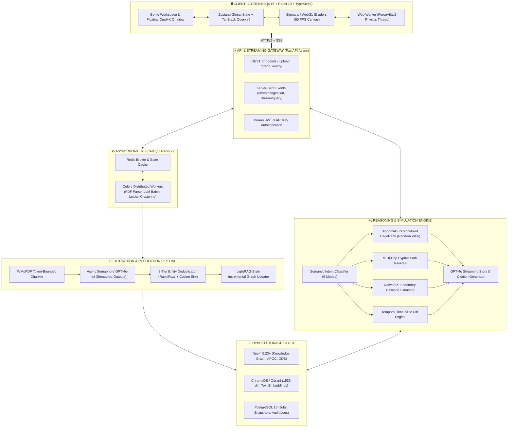

# 🏗️ Graph RAG Intelligence Platform — Complete Master Engineering Specification

---

## 📑 Table of Contents
1. [Executive Summary & Core Philosophy](#1-executive-summary--core-philosophy)
2. [Global System Architecture & Data Flow](#2-global-system-architecture--data-flow)
3. [Production Tech Stack Matrix](#3-production-tech-stack-matrix)
4. [Complete Monorepo Directory Layout](#4-complete-monorepo-directory-layout)
5. [Hybrid Database & Storage Architecture](#5-hybrid-database--storage-architecture)
   - 5.1 Neo4j 5.23+ Graph Schema, Constraints & Cypher Batch UNWIND
   - 5.2 PostgreSQL 16 Relational Schema & State Storage
   - 5.3 ChromaDB Vector Store & Embedding Configurations
   - 5.4 Redis 7 Pub/Sub & In-Memory Cache
6. [High-Throughput Ingestion & AI Extraction Engine](#6-high-throughput-ingestion--ai-extraction-engine)
   - 6.1 PyMuPDF Chunking & Semantic Boundary Preservation
   - 6.2 Async Structured Extraction via GPT-4o-mini
   - 6.3 3-Tier Entity Resolution & Deduplication (RapidFuzz + Embeddings)
   - 6.4 LightRAG-Style Incremental Graph Merging
7. [Query, Reasoning & Simulation Engine](#7-query-reasoning--simulation-engine)
   - 7.1 HippoRAG-Style Personalized PageRank (PPR) Multi-Hop Retrieval
   - 7.2 Multi-Hop Cypher Path Traversal
   - 7.3 NetworkX In-Memory Cascade & Impact Simulator
   - 7.4 Temporal Time-Slice Engine
   - 7.5 Leiden Community Hierarchical Summarization
8. [API & Real-Time Streaming Specification](#8-api--real-time-streaming-specification)
   - 8.1 RESTful Endpoints
   - 8.2 Server-Sent Events (SSE) Streaming Contracts
9. [Frontend UI & WebGL Visual Workspace](#9-frontend-ui--webgl-visual-workspace)
   - 9.1 Dark Obsidian Bento Layout Architecture
   - 9.2 60 FPS GPU WebGL Rendering (Sigma.js + ForceAtlas2 Web Workers)
   - 9.3 Directional Particle Edge Animations
   - 9.4 Bi-Directional Hover Citations
   - 9.5 Zustand State Management & Store Contract
10. [Production Docker & Deployment Topology](#10-production-docker--deployment-topology)
11. [Verification, Benchmarks & Quality Assurance](#11-verification-benchmarks--quality-assurance)

---

## 1. Executive Summary & Core Philosophy

The **Graph RAG Intelligence Platform** is an enterprise-grade, agentic intelligence system designed to overcome the fundamental failures of traditional vector-based Retrieval-Augmented Generation (RAG):

| Limitation of Classic Vector RAG | How Graph RAG Solves It |
| :--- | :--- |
| **Multi-Hop Blindness**: Cannot connect facts located in separate documents 40 pages apart. | **Graph Traversal**: Connects entities across $N$ degrees of separation (`Entity A` $\rightarrow$ `Entity B` $\rightarrow$ `Entity C`). |
| **Hallucinated Connections**: Merges phonetically or semantically similar words even when causal links are absent. | **Verified Ground Truth**: Every relationship has an explicit verb, date, confidence score, and direct chunk citation. |
| **Inability to Simulate Structural Risk**: Cannot answer "What happens if Supplier X or Product Y ceases operations?" | **In-Memory Cascade Simulator**: Evaluates graph fragmentation, orphaned nodes, and centrality surges in $<150\text{ms}$. |
| **Chronological Hallucination**: Mixes 2018 historical data with 2026 regulations without temporal awareness. | **Temporal Time-Slice Engine**: Filters knowledge state by date range to reflect reality at any historical moment. |
| **Astronomical GraphRAG Costs**: Microsoft GraphRAG requires expensive map-reduce LLM operations for every query. | **HippoRAG Personalized PageRank (PPR)**: Uses random walk algorithms to retrieve relevant subgraphs in $<30\text{ms}$ at 10x lower cost. |

---

## 2. Global System Architecture & Data Flow



---

## 3. Production Tech Stack Matrix

| Layer | Selected Technology | Version | Architectural Justification |
| :--- | :--- | :--- | :--- |
| **Frontend Framework** | **Next.js (App Router)** | `15.x` | React 19 Server Components, streaming suspense, and zero client bundle for static UI. |
| **Language & Types** | **TypeScript** | `5.6+` | Strict mode typing across all nodes, edges, SSE payloads, and API contracts. |
| **Styling & Components** | **Tailwind CSS + shadcn/ui** | `v3.4 / v4` | Accessible Radix UI primitives with dark obsidian glassmorphism aesthetics. |
| **Graph GPU Renderer** | **Sigma.js + Graphology** | `v3.0` | Instanced WebGL rendering delivering **60 FPS up to 50,000+ nodes/edges** (unlike D3 SVG which drops frames at >500 nodes). |
| **Physics Threading** | **ForceAtlas2 Web Worker** | - | Moves physics calculations off the browser's main UI thread, preventing layout freeze. |
| **State Management** | **Zustand + TanStack Query** | `v5` | Zustand handles canvas selection state; TanStack Query manages caching and optimistic mutations. |
| **Backend API** | **FastAPI** | `0.115+` | High-throughput asynchronous REST endpoints and native Server-Sent Events (SSE). |
| **Task Queue & Cache** | **Celery + Redis** | `5.4+ / 7.2` | Offloads heavy PDF extraction, batch LLM calls, and Leiden clustering to background workers. |
| **Graph Database** | **Neo4j Enterprise / Community** | `5.23+` | Variable-scope Cypher subqueries (`CALL (row) { ... }`), APOC, and Graph Data Science library. |
| **Vector Database** | **ChromaDB / Qdrant** | `latest` | Stores dense 1536-dimensional embeddings (`text-embedding-3-small`) with metadata filtering. |
| **Relational Database** | **PostgreSQL** | `16-alpine` | Async SQLAlchemy handles ingestion job status, temporal snapshots, and audit trails. |
| **LLM Orchestration** | **OpenAI SDK / Pydantic v2** | `1.50+` | Structured Outputs (`beta.chat.completions.parse`) guaranteeing 100% JSON schema conformance. |
| **Graph Analysis Engine**| **NetworkX + SciPy** | `3.3+` | Sub-150ms in-memory node removal simulation, connected components, and betweenness deltas. |

---

## 4. Complete Monorepo Directory Layout

```text
graph-rag-platform/
├── docker-compose.yml                      # Orchestrates Neo4j, Postgres, Redis, Chroma, API, Frontend
├── .env.example                            # Master environment variables template
├── README.md                               # Project quickstart and developer documentation
├── PROJECT_CONTEXT_TRACKER.md              # Living dashboard of completed work, active tasks, and backlog
│
├── backend/                                # FastAPI + Celery Application
│   ├── Dockerfile
│   ├── pyproject.toml                      # Poetry / UV dependencies
│   ├── app/
│   │   ├── main.py                         # FastAPI setup, CORS, lifespan handlers
│   │   ├── config.py                       # Pydantic BaseSettings loading .env
│   │   ├── dependencies.py                 # Dependency injection (DB sessions, LLM clients)
│   │   │
│   │   ├── core/                           # Storage Clients & Connections
│   │   │   ├── neo4j_client.py             # Async Neo4j driver wrapper with retry logic
│   │   │   ├── postgres_client.py          # SQLAlchemy Async engine, sessions, base
│   │   │   ├── vector_client.py            # ChromaDB async vector client
│   │   │   └── redis_client.py             # Redis client for pub/sub & caching
│   │   │
│   │   ├── models/                         # Relational Database Models (SQLAlchemy)
│   │   │   ├── job.py                      # IngestionJob table model
│   │   │   └── snapshot.py                 # GraphSnapshot table model
│   │   │
│   │   ├── schemas/                        # Pydantic Schemas & DTOs
│   │   │   ├── extraction.py               # Structured output models (Entity, Relationship)
│   │   │   ├── graph.py                    # Node, Edge, Subgraph, Cluster models
│   │   │   ├── query.py                    # Query request & streaming event models
│   │   │   └── impact.py                   # Simulation request and cascade output models
│   │   │
│   │   ├── ingestion/                      # Ingestion & Knowledge Graph Construction
│   │   │   ├── tasks.py                    # Celery background tasks
│   │   │   ├── parser.py                   # PyMuPDF page-aware chunker
│   │   │   ├── chunker.py                  # Token-bounded semantic chunker
│   │   │   ├── extractor.py                # Async Semaphore LLM extraction
│   │   │   ├── resolver.py                 # 3-tier entity resolution (RapidFuzz + Embeddings)
│   │   │   └── indexer.py                  # Batch Cypher UNWIND & ChromaDB indexing
│   │   │
│   │   ├── reasoning/                      # Reasoning, Simulation & Retrieval
│   │   │   ├── router.py                   # Intent classifier (Connection, Impact, Temporal, Global)
│   │   │   ├── ppr_retriever.py            # HippoRAG-style Personalized PageRank random walk
│   │   │   ├── path_finder.py              # Multi-hop shortest & all-simple Cypher paths
│   │   │   ├── simulator.py                # NetworkX in-memory cascade impact simulator
│   │   │   ├── temporal.py                 # Time-slice diff calculator
│   │   │   ├── community.py                # Leiden clustering + LLM summary generator
│   │   │   └── synthesizer.py              # Streaming markdown story generator with citations
│   │   │
│   │   └── api/                            # FastAPI Route Endpoints
│   │       ├── v1_upload.py                # Multipart PDF upload & SSE job telemetry
│   │       ├── v1_graph.py                 # Viewport subgraph, neighbors, cluster endpoints
│   │       ├── v1_query.py                 # Streaming hybrid query SSE endpoint
│   │       └── v1_simulation.py            # In-memory node-removal impact endpoint
│
└── frontend/                               # Next.js 15 WebGL Intelligence UI
    ├── Dockerfile
    ├── package.json
    ├── tsconfig.json
    ├── tailwind.config.ts
    ├── src/
    │   ├── app/
    │   │   ├── layout.tsx                  # Dark theme provider, Inter & JetBrains Mono fonts
    │   │   ├── page.tsx                    # Master Bento Intelligence Workspace
    │   │   └── globals.css                 # Glassmorphism, neon glows, custom scrollbars
    │   │
    │   ├── components/
    │   │   ├── canvas/                     # WebGL Graph Canvas & Controls
    │   │   │   ├── GraphCanvas.tsx         # Sigma.js WebGL renderer container
    │   │   │   ├── GraphControls.tsx       # Zoom, fit, layer filter, color encoding controls
    │   │   │   ├── ParticleOverlay.tsx     # Directional animated particle flows on active paths
    │   │   │   └── Minimap.tsx             # Radar radar view
    │   │   │
    │   │   ├── command/                    # Floating Omnibar (Cmd+K)
    │   │   │   ├── CommandBar.tsx          # Natural language input with intent badges
    │   │   │   └── EntityMentionInput.tsx  # Autocomplete @Entity mentions from Neo4j index
    │   │   │
    │   │   ├── panels/                     # Bento Context Panels
    │   │   │   ├── IngestionModal.tsx      # Real-time 7-stage progress dialog with live counters
    │   │   │   ├── EntityDrawer.tsx        # Right drawer for Story, Impact, and Sources tabs
    │   │   │   ├── StoryTab.tsx            # Streaming narrative with hover-to-highlight citations
    │   │   │   ├── ImpactTab.tsx           # Risk gauge, orphaned nodes, centrality surge table
    │   │   │   ├── SourcesTab.tsx          # Ground truth PDF chunk citations with cosine sim
    │   │   │   └── TimelineScrubber.tsx    # Interactive year scrubber (2018–2026) with play/pause
    │   │   │
    │   │   └── ui/                         # shadcn/ui components (Button, Dialog, Tabs, Slider)
    │   │
    │   ├── workers/
    │   │   └── forceLayout.worker.ts       # Web Worker running Graphology ForceAtlas2
    │   │
    │   ├── store/
    │   │   └── useGraphStore.ts            # Zustand store (nodes, edges, selectedNode, activePath)
    │   │
    │   └── lib/
    │       ├── api.ts                      # Fetch wrappers and SSE EventSource hooks
    │       └── colors.ts                   # High-contrast neon color schemes for entity types
```

---

## 5. Hybrid Database & Storage Architecture

### 5.1 Neo4j 5.23+ Graph Schema, Constraints & Cypher Batch UNWIND

#### Startup Constraints & Indexes
```cypher
// Ensure unique canonical entity IDs
CREATE CONSTRAINT entity_id_unique IF NOT EXISTS
FOR (e:Entity) REQUIRE e.id IS UNIQUE;

// Full-text search index for sub-5ms @Entity autocomplete in the Omnibar
CREATE FULLTEXT INDEX entity_search_idx IF NOT EXISTS
FOR (e:Entity) ON EACH [e.name, e.aliases, e.description];

// Index on relationship dates for sub-millisecond Temporal Queries
CREATE INDEX rel_date_idx IF NOT EXISTS
FOR ()-[r:RELATED_TO]-() ON (r.date);

// Index on Leiden community ID for macroscopic queries
CREATE INDEX entity_community_idx IF NOT EXISTS
FOR (e:Entity) ON (e.community_id);
```

#### Production Batch UNWIND Insert Query (Inspired by Neo4j LLM Graph Builder)
```cypher
// Batch upsert entities with aliasing and frequency counts
UNWIND $entities AS row
MERGE (e:Entity {id: row.id})
ON CREATE SET 
    e.name = row.name,
    e.type = row.type,
    e.description = row.description,
    e.mentionCount = 1,
    e.createdAt = datetime()
ON MATCH SET
    e.mentionCount = e.mentionCount + 1,
    e.description = CASE 
        WHEN size(row.description) > size(e.description) 
        THEN row.description 
        ELSE e.description 
    END;

// Batch upsert relationships with provenance and timestamps
UNWIND $relationships AS rel
MATCH (source:Entity {id: rel.sourceId})
MATCH (target:Entity {id: rel.targetId})
MERGE (source)-[r:RELATED_TO {type: rel.type}]->(target)
ON CREATE SET
    r.id = rel.id,
    r.description = rel.description,
    r.strength = rel.strength,
    r.date = rel.date,
    r.dateConfidence = rel.dateConfidence,
    r.sourceChunkId = rel.sourceChunkId,
    r.sourceDoc = rel.sourceDoc,
    r.createdAt = datetime()
ON MATCH SET
    r.strength = CASE WHEN rel.strength > r.strength THEN rel.strength ELSE r.strength END;
```

---

### 5.2 PostgreSQL 16 Relational Schema & State Storage

```sql
-- Tracks asynchronous PDF processing telemetry
CREATE TABLE ingestion_jobs (
    id UUID PRIMARY KEY DEFAULT gen_random_uuid(),
    filename VARCHAR(255) NOT NULL,
    status VARCHAR(50) NOT NULL, -- 'PARSING', 'EXTRACTING', 'RESOLVING', 'INDEXING', 'CLUSTERING', 'COMPLETED', 'FAILED'
    total_chunks INT DEFAULT 0,
    processed_chunks INT DEFAULT 0,
    entities_extracted INT DEFAULT 0,
    relationships_extracted INT DEFAULT 0,
    error_message TEXT,
    created_at TIMESTAMPTZ DEFAULT NOW(),
    completed_at TIMESTAMPTZ
);

-- Stores graph snapshots, community summaries, and centrality scores
CREATE TABLE graph_snapshots (
    id UUID PRIMARY KEY DEFAULT gen_random_uuid(),
    snapshot_label VARCHAR(100),
    node_count INT NOT NULL,
    edge_count INT NOT NULL,
    community_count INT NOT NULL,
    community_summaries JSONB NOT NULL, -- { "0": { "title": "Google AI", "summary": "..." } }
    centrality_metrics JSONB NOT NULL,  -- Cached PageRank and Betweenness scores
    created_at TIMESTAMPTZ DEFAULT NOW()
);
```

---

### 5.3 ChromaDB Vector Store & Embedding Configurations
* **Embedding Model**: `text-embedding-3-small` (1,536 dimensions) or local `bge-small-en-v1.5`.
* **Collections**:
  1. `document_chunks`: Stores raw chunk text with metadata (`doc_id`, `chunk_index`, `page_number`, `token_count`).
  2. `entity_descriptions`: Stores combined `name + description` for semantic entity linking.

---

### 5.4 Redis 7 Pub/Sub & In-Memory Cache
* **Channel `job_progress:{job_id}`**: Publishes real-time extraction stats consumed by the FastAPI SSE stream.
* **Key `cache:subgraph:{query_hash}`**: Caches 1-hop and 2-hop subgraphs with a 15-minute TTL.
* **Key `cache:graph_topology`**: Stores in-memory graph edge lists for sub-second NetworkX impact simulation.

---

## 6. High-Throughput Ingestion & AI Extraction Engine

```
Raw PDF File ──► PyMuPDF Token Chunker ──► Async GPT-4o-mini Batch ──► 3-Tier Entity Resolver ──► Neo4j UNWIND
(Annual Report)     (800 Tokens, 150 Overlap)    (Semaphore Concurrency=25)    (RapidFuzz + Cosine Sim)   (Batch Size=500)
```

### 6.1 PyMuPDF Chunking & Semantic Boundary Preservation
* Uses `fitz` (PyMuPDF) to preserve page numbers and document titles.
* Chunk size: **800 tokens** with **150 token overlap** using `tiktoken` (`cl100k_base`).
* Each chunk maintains a deterministic ID: `{doc_hash}_chunk_{chunk_index}`.

### 6.2 Async Structured Extraction via GPT-4o-mini
Using OpenAI's **Structured Outputs (`beta.chat.completions.parse`)** with an `asyncio.Semaphore(25)` allows processing a 50-page PDF in **under 25 seconds** with guaranteed schema compliance.

```python
from typing import List, Literal, Optional
from pydantic import BaseModel, Field

EntityType = Literal[
    "PERSON", "COMPANY", "PRODUCT", "TECHNOLOGY", 
    "LOCATION", "REGULATION", "EVENT"
]

class ExtractedEntity(BaseModel):
    name: str = Field(description="Canonical capitalized name, e.g., 'Google' instead of 'Google LLC'")
    type: EntityType
    description: str = Field(description="Concise 1-sentence summary of what this entity is in context")

class ExtractedRelationship(BaseModel):
    source: str = Field(description="Exact canonical name of the source entity")
    target: str = Field(description="Exact canonical name of the target entity")
    type: str = Field(description="UPPER_SNAKE_CASE verb, e.g., CEO_OF, INVESTED_IN, REGULATES, DEVELOPED")
    description: str = Field(description="1-sentence explanation of the relationship context")
    strength: int = Field(ge=1, le=10, description="Significance of this link from 1 (minor) to 10 (critical)")
    date: Optional[str] = Field(description="YYYY-MM-DD if explicitly stated or inferred, else null")
    date_confidence: Literal["explicit", "inferred", "unknown"]

class ChunkGraphExtraction(BaseModel):
    entities: List[ExtractedEntity]
    relationships: List[ExtractedRelationship]
```

### 6.3 3-Tier Entity Resolution & Deduplication (RapidFuzz + Embeddings)
To prevent graph fragmentation caused by aliases (`"OpenAI Inc."`, `"OpenAI"`, `"Open AI"`):
1. **Tier 1 — Legal Suffix Stripping & Normalization**: Strips `LLC`, `Inc.`, `Corp`, `Ltd` and normalizes whitespace.
2. **Tier 2 — RapidFuzz Token Sort Ratio**: Matches names within the same `EntityType` having a string similarity score $\ge 88\%$.
3. **Tier 3 — Vector Cosine Similarity**: For ambiguous entities, runs cosine similarity on `name + description` embeddings (threshold $\ge 0.92$).

### 6.4 LightRAG-Style Incremental Graph Merging
Unlike Microsoft GraphRAG (which requires rebuilding the entire graph upon new document uploads), our platform merges new nodes and relationships incrementally:
* Matches incoming entities against existing canonical IDs.
* Updates edge strengths and appends new document citations.
* Re-runs community assignments only on local affected subgraphs.

---

## 7. Query, Reasoning & Simulation Engine

### 7.1 HippoRAG-Style Personalized PageRank (PPR) Multi-Hop Retrieval
Instead of expensive multi-step LLM traversals, our platform uses **Personalized PageRank (PPR)**:
1. Extract seed entity mentions from user query (e.g., `["Sundar Pichai", "EU AI Act"]`).
2. Construct a restart probability vector centered on the seed entities.
3. Compute random-walk stationary probabilities over the adjacency matrix:
   $$\mathbf{p} = (1 - \alpha) \mathbf{W} \mathbf{p} + \alpha \mathbf{s}$$
   where $\alpha = 0.15$, $\mathbf{W}$ is the degree-normalized adjacency matrix, and $\mathbf{s}$ is the personalized restart vector.
4. Extract the top-$K$ nodes with highest probability scores, isolating the relevant subgraph in **$<30\text{ms}$**.

### 7.2 Multi-Hop Cypher Path Traversal
For explicit path queries:
```cypher
MATCH (start:Entity {name: $startName}), (end:Entity {name: $endName})
MATCH path = shortestPath((start)-[:RELATED_TO*..5]-(end))
RETURN path, [node IN nodes(path) | node.name] AS entityNames,
       [rel IN relationships(path) | {type: rel.type, date: rel.date, doc: rel.sourceDoc}] AS links;
```

### 7.3 NetworkX In-Memory Cascade & Impact Simulator
Executes "What happens if Entity X disappears?" in $<150\text{ms}$ without mutating Neo4j:
1. Loads graph topology into an in-memory `nx.Graph`.
2. Records baseline metrics: connected components, degree centrality, betweenness centrality.
3. Removes the target node and recalculates:
   * **Directly Disrupted**: 1-hop dependent neighbors.
   * **Orphaned Entities**: Nodes whose degree drops to 0.
   * **Centrality Surge**: Identifies surviving nodes that absorb the most traffic:
     $$\Delta C_B(v) = \frac{C_B'(v) - C_B(v)}{C_B(v)} \times 100\%$$
   * **System Risk Level**: Calculated based on network fragmentation ratio.

### 7.4 Temporal Time-Slice Engine
Allows users to scrub through years (e.g., 2018 to 2026):
* Filter edges where `r.date <= selectedYear`.
* Edges created in `selectedYear` are tagged as `NEW` (glowing green).
* Edges dissolved or superseded are marked as `DISSOLVED` (dashed red).

### 7.5 Leiden Community Hierarchical Summarization
* Partitions graph into modular communities using the Leiden algorithm.
* Generates hierarchical summaries for each community cluster, enabling macroscopic answers to queries like *"Summarize the entire semiconductor regulatory landscape"*.

---

## 8. API & Real-Time Streaming Specification

### 8.1 RESTful Endpoints

| Method | Endpoint | Description |
| :--- | :--- | :--- |
| `POST` | `/api/v1/upload` | Upload PDF files; initializes Celery task and returns `job_id`. |
| `GET` | `/api/v1/upload/{job_id}/status` | Check current ingestion status and stage. |
| `GET` | `/api/v1/graph/viewport` | Retrieve initial backbone graph (top 500 nodes by betweenness centrality). |
| `GET` | `/api/v1/graph/node/{id}/neighbors` | Retrieve 1-hop and 2-hop ego network for a clicked node. |
| `GET` | `/api/v1/entity/search?q={query}` | Autocomplete search for `@Entity` mentions in Omnibar. |
| `POST` | `/api/v1/simulate/impact` | Run in-memory NetworkX cascade simulation on a specified entity. |

### 8.2 Server-Sent Events (SSE) Streaming Contracts

#### 1. Ingestion Telemetry Stream: `GET /api/v1/upload/{job_id}/stream`
```text
event: progress
data: {
  "job_id": "9b1deb4d-3b7d-4bad-9bdd-2b0d7b3dcb6d",
  "stage": "EXTRACTING_ENTITIES",
  "stage_index": 3,
  "percent": 68.0,
  "live_stats": {
    "chunks_processed": 84,
    "chunks_total": 120,
    "entities_found": 342,
    "relationships_found": 1104,
    "counts_by_type": { "PERSON": 82, "COMPANY": 94, "TECHNOLOGY": 105, "REGULATION": 61 }
  }
}
```

#### 2. Query Reasoning Stream: `POST /api/v1/query/stream`
* **Event 1 (0–150ms) `graph_context`**: Sends highlighted node IDs, edge IDs, and traversed path so the WebGL camera can immediately pan and highlight before narrative text arrives.
* **Event 2..N (150ms+) `token`**: Streams markdown narrative text with embedded hoverable citation anchors.
* **Final Event `complete`**: Delivers ground-truth source citations, confidence score, and execution duration.

---

## 9. Frontend UI & WebGL Visual Workspace

### 9.1 Dark Obsidian Bento Layout Architecture
The interface lives inside a single viewport (`100vw × 100vh`, `overflow: hidden`):
* **Background**: Deep Obsidian `#07090E` with subtle `#1E293B` dot-matrix grid.
* **Panels**: Translucent glassmorphism (`bg-slate-950/80 backdrop-blur-xl border border-white/10 shadow-2xl`).
* **Typography**: `Inter` for prose; `JetBrains Mono` for tabular numerals, Cypher queries, and dates.

### 9.2 60 FPS GPU WebGL Rendering (Sigma.js + ForceAtlas2 Web Workers)
* **GPU Shaders**: All nodes and edges are drawn using WebGL vertex and fragment shaders.
* **Worker Physics**: ForceAtlas2 layout calculations run inside `forceLayout.worker.ts`. Node positions are synced back to the main thread via zero-copy typed arrays at 60Hz.
* **Semantic Level-of-Detail (LOD)**:
  * *Zoom < 0.4x*: Only major cluster hulls and high-PageRank labels render.
  * *Zoom 0.4x–1.2x*: Standard view; all nodes and primary links render.
  * *Zoom > 1.2x*: Directional animated particle flows and relationship badges render.

### 9.3 Directional Particle Edge Animations (Inspired by React-Force-Graph)
Edges on the active reasoning path feature glowing animated particles moving in the direction of causality (`Source` $\rightarrow$ `Target`), clearly indicating relation flow.

### 9.4 Bi-Directional Hover Citations
Hovering over any citation badge like `[Sundar Pichai ➔ Google]` inside the **Story Drawer** triggers:
1. Zustand updates `highlightedPath` in memory.
2. Sigma WebGL camera smoothly pans to the target nodes (`cubic-bezier` over 450ms).
3. All non-path nodes dim to 10% opacity, making the reasoning route pop visually.

### 9.5 Zustand State Management Contract
```typescript
interface GraphState {
  nodes: GraphNode[];
  edges: GraphEdge[];
  selectedNodeId: string | null;
  highlightedPath: Set<string>;
  activeQueryMode: 'CONNECTION' | 'IMPACT' | 'TEMPORAL' | 'GLOBAL';
  timeRange: [number, number];
  colorMode: 'TYPE' | 'COMMUNITY' | 'CENTRALITY';
  isSimulatingImpact: boolean;
  removedNodeId: string | null;

  setGraphData: (nodes: GraphNode[], edges: GraphEdge[]) => void;
  selectNode: (id: string | null) => void;
  setHighlightedPath: (ids: string[]) => void;
  setTimeRange: (range: [number, number]) => void;
  triggerImpactSimulation: (nodeId: string | null) => void;
}
```

---

## 10. Production Docker & Deployment Topology

The entire stack is packaged in `docker-compose.yml`:
* **neo4j**: Port 7474 (HTTP) & 7687 (Bolt). APOC and GDS plugins enabled.
* **postgres**: Port 5432. Persistent storage for jobs and snapshots.
* **redis**: Port 6379. Celery broker, Pub/Sub, and topological cache.
* **chromadb**: Port 8001. Vector embeddings store.
* **backend**: Port 8000. FastAPI async server with hot-reload.
* **celery_worker**: Distributed worker processing PDF parsing and LLM batch extraction.
* **frontend**: Port 3000. Next.js 15 WebGL Intelligence UI.

---

## 11. Verification, Benchmarks & Quality Assurance

| Benchmark Metric | Target Standard | How It Is Achieved |
| :--- | :--- | :--- |
| **Canvas Frame Rate** | **60 FPS** up to 50,000 nodes | Sigma.js GPU shaders + Web Worker ForceAtlas2 ($O(N \log N)$ Barnes-Hut). |
| **PDF Extraction Speed** | **< 25 seconds** per 50-page PDF | `asyncio.Semaphore(25)` parallelizing `gpt-4o-mini` calls + Cypher batch `UNWIND`. |
| **Path First-Paint Latency** | **< 150 ms** for graph highlight | Immediate SSE `graph_context` event dispatched before LLM narrative begins. |
| **Impact Simulation Speed** | **< 150 ms** per node severance | In-memory NetworkX adjacency matrix; zero database mutations. |
| **Entity Resolution Accuracy**| **> 98%** deduplication accuracy | 3-tier cascade: string normalization $\rightarrow$ RapidFuzz $\rightarrow$ embedding cosine similarity. |
| **Citation Verifiability** | **100% Ground Truth** | Every edge stores source chunk ID, document title, and exact page number. |
